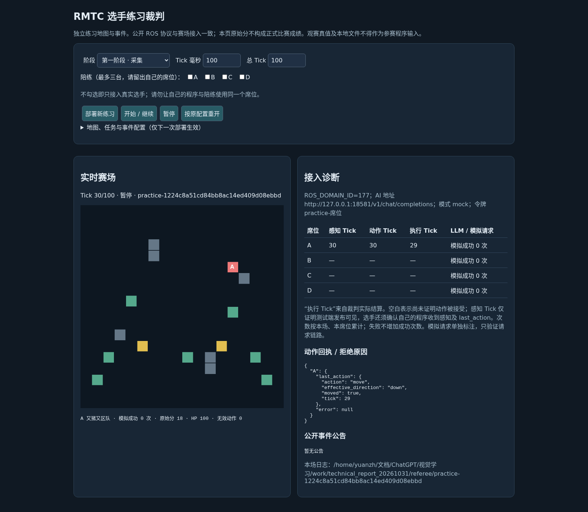
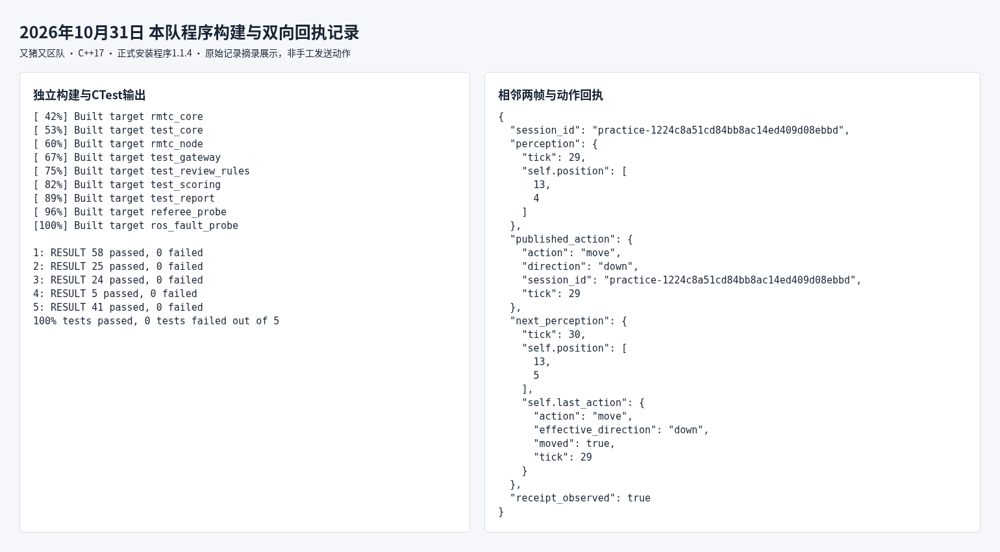

# RMTC机甲大师图灵对决赛自主机器人技术报告

参赛队伍：又猪又区队    队员及负责人：袁正航

代码修订：1.1.4    开发语言：C++17    提交日期：2026年10月31日

## 一 整体设计思路

本队采用 C++17 与 ROS 2 Humble 实现自主机器人。系统从本队公开感知读取当前位置、血量、可见实体、任务及裁判积分，维护有限地图记忆，以加权最短路和战术收益比较选择每一 Tick 的动作。自然语言随机事件交由大语言模型理解，模型请求在后台执行，解析结果经校验后才进入规划。

设计目标是在有限视野和固定动作窗口内稳定行动，同时兼顾采集、任务、对抗收益与生存。机器人每帧重新规划，只提交当前一步；不读取裁判管理数据、其他队伍专属感知或观赛全图作为策略输入。

### 系统数据流

本队感知 → JSON与场次校验 → 地图及事件状态更新 → 加权寻路 → 候选收益比较 → 动作发布 → 下一帧执行回执核对。公告另经后台网关请求 → 模型结果校验 → 事件状态更新。

### 技术选型与职责

| 组成 | 实现方式 | 选用原因 |
|---|---|---|
| 通信 | rclcpp 与 std_msgs/String | 兼容ROS 2 Humble，按席位收发 |
| 决策 | C++17本地规划与战术评估 | 控制链路无需等待网络模型 |
| 模型访问 | libcurl与独立工作线程 | 隔离超时、重试及响应校验 |
| 数据与交付 | nlohmann/json、CMake、colcon | 严格结构校验，支持本机复现 |

本文以新发布的赛事规则v1.2、参赛手册及测试端教程v1.1核对提交要求。代码已有测试证据主要对应v1.1练习端；正式v1.2赛场、真实AI与异机有线接入尚未完成验收，不将练习成绩写作正式成绩。v1.2不再要求提交容器镜像，已有镜像作为可选复现材料保留。


## 二 代码组织与运行逻辑

| 文件 | 职责 |
|---|---|
| src/node.cpp | ROS订阅与动作发布、注册、诊断和配置轮询 |
| src/protocol.cpp | 严格读取感知JSON、坐标转换与动作构造 |
| src/controller.cpp | session切换、Tick去重、缓存重放和模型结果协调 |
| src/world.cpp | 可见地图、障碍、资源、访问历史及移动记忆 |
| src/planner.cpp | 加权Dijkstra、资源任务目标及动作选择 |
| src/tactics.cpp 与 scoring.cpp | 战斗预测、比例伤害、击杀分奖和死亡扣除 |
| src/events.cpp 与 prompts.cpp | 模型事件结果校验、有效期与固定提示词 |
| src/gateway.cpp 与 audit.cpp | HTTP异步请求、有界日志队列与后台写入 |

### 每一帧如何处理

控制器先识别session_id。进入新场次时清空上场地图、事件和规划状态；已退役场次与旧Tick不再推进。相同场次、相同Tick重发时返回缓存动作，不重复增加访问次数或规划步数。新Tick到达后，先更新公开状态，再调用规划器。到达结束Tick后不再发动作，阵亡期间提交wait。

每个动作携带当前感知的tick与session_id。世界状态只依据self.position和真实回执更新，不因发出了MOVE就假设移动成功；撞墙、争格和幻术后的实际移动均以裁判记录为准。重启及复活也从当前公开位置恢复，不自行猜测复活点。

### 坐标如何转换

可见实体的9×9图以中心为本车，行列从1计数时中心为第5行第5列。偏移为dx=列−5、dy=行−5，再加self.position得到绝对坐标。例如本车[8,8]、实体在第3行第6列，实体坐标为[9,6]。地图尺寸从每帧读取，不把20×20或24×24写死为所有场次的唯一尺寸。

ROS感知和动作使用RELIABLE、VOLATILE、KEEP_LAST(1)。注册消息用于显示本队名称，动作身份由席位话题确定；不在动作JSON中伪造队伍归属。


## 三 寻路与候选收益比较

### 地图记忆与加权寻路

机器人保存已看见的障碍、资源和访问记录。资源离开视野后保留记忆，同时随信息年龄降低吸引力；重新看到时刷新，避免把陈旧记忆等同于当前资源真值。已知障碍、临时封锁和其他存活车辆占据的位置不能作为可进入格。

寻路使用带优先队列的Dijkstra。一步成本由基础步长、重复访问偏好、敌人威胁及已知事件危险组成。对普通敌人按直线1—2格识别火线，对已知无双敌人按5×5区域识别威胁。cost负责比较路径偏好，depth保存实际步数并计算预计到达Tick，二者不混用。

第一阶段比较资源价值、到达成本和探索收益，动作限定为move/wait。第二阶段在相同框架中加入任务、接敌、治疗与事件目标。资源上限和伤害封顶会影响边际收益，已经完成的任务ID不会因之后积分下降而撤销。

### 战术模型与结算顺序

同一Tick先战斗、后移动，因此MOVE不能躲开本Tick已经结算的攻击。候选先预测当前战斗后能否存活，再评估移动、辣椒触发或治疗价值。天使候选按战后HP估计可恢复血量，避免在先受伤的场景中低估治疗；本Tick死亡则不能赋予入点回血收益。

战斗估值区分实际攻击贡献、击杀奖励及死亡扣除。多车集火按剩余HP比例分摊攻击贡献，致死批次的合格贡献者按队伍去重分奖。预测仅用于选动作，真实资源值与调整后有效伤害始终读取裁判感知，不把预测结果写回真实积分。

### 生存前瞻与追逐退避

1.1.4只在HP≤40、当前普通移动仍可存活且还有下一Tick时加入短期火线风险，比较原地攻击、防御与脱离火线。健康状态恢复即时收益比较，避免对所有动作叠加“下一Tick自己WAIT”的悲观损失。40是启发式门槛，不是裁判规则，也不保证多敌人情况下绝对安全。

连续接敌而有效伤害未增长时触发8Tick检测、12Tick暂停接敌。接近与巡逻交替不会清零无进展计数，冷却期间仍可选择已经能够兑现的攻击。实验中延长追逐虽提高D场伤害，却明显损害B/C场，因此未采用该候选。


## 四 模型接入与功能完成情况

LLM用于理解公开自然语言事件，C++负责实际动作。当前具备爆炸、幻术、易伤、天使、天下无双、世界分裂、火爆辣椒和洁身自好八类事件的结构化结果校验与策略入口。事件发生时间、位置和参数取自模型理解结果，不以关键词、正则或固定时间表替代模型解析。

后台线程统一处理请求、超时、退避与去重。模型结果须通过JSON结构、坐标、枚举、场次与时效检查；旧场次结果不提交，重试中的provisional结果不提前应用。暂时无法使用模型时，主循环继续基于已知公开信息进行本地规划。

| 功能 | 当前状态 | 证据或限制 |
|---|---|---|
| 两阶段自主行动 | 已实现并测试 | 阶段1采集；阶段2完整500Tick对局 |
| 场次与重复Tick管理 | 已实现并测试 | 缓存重放、旧帧/旧场次丢弃 |
| 事件理解接入 | 接口与校验已实现 | 固定合法回复链路通过；真实语义待验 |
| HTTP故障与日志降级 | 已实现并测试 | 限流、超时、额度及不可写路径测试 |
| 四种策略切换 | 已实现 | 仅登记枚举；按裁判批准流程执行 |
| 真实AI及现场网络 | 待验收 | 不以mock成功、车辆移动替代验收 |

### 正式模型配置

新参赛手册指定模型deepseek-flash、max_tokens为512，完整地址和本场席位令牌由工作人员发放。当前程序支持--model与--max-tokens，因此启动时显式传入，避免沿用1600的默认输出上限。请求使用POST /v1/chat/completions和Bearer认证。

当前请求固定temperature=0，未显式发送thinking与response_format。群公告提供的关闭思考和JSON模式是可用接入选项，本文不宣称已实现或已测通；能否满足现场时延和返回格式需用正式/真实模型实测。输出上限512可能截断较长事件结果，需要现场联调确认。

本地默认成功响应预算48次是保守配置，正式额度以主办方通知为准。HTTP成功、模型语义有效、正式AI计分资格是三个不同判断，正式每场资格以裁判本场本席位真实成功记录为准。


## 五 测试方法与结果

验证分三层：单元测试检查协议与策略边界；实际ROS探针验证断流、恢复、回执和故障降级；练习端完整对局核对感知、动作与后续回执。10月31日独立构建并重跑5个CTest程序，共153项命名检查，0失败；其中一个低HP检查含144种方向、血量、距离和位置组合。

| 场景与席位 | 练习得分 60分制 | 有效伤害D | 非法动作 |
|---|---|---|---|
| A 默认地图 | 45.0 | 525 | 0 |
| B 自定义种子20261023 | 55.0 | 510 | 0 |
| C 自定义种子20261025 | 42.5 | 500 | 0 |
| D 自定义种子20261026 | 49.6 | 320 | 0 |

上表为1.1.4在10月25日保存的四场第二阶段结果，均完整500动作Tick，逐Tick回执检查通过，平均48.025/60。字母表示不同地图与席位的测试场景，不代表四支真实参赛队。使用固定陪练和mock模型，练习任务预览分不证明正式AI资格，不能作为正式成绩预测。

第一阶段历史7场由1.1.3运行：平均36.2857/40，最低30/40，默认3场均40/40。1.1.4未修改第一阶段采集策略；10月31日又用当前安装程序新跑1场完整100动作Tick，得到40/40、资源值200、非法动作0，暂停恢复后完成。该场与历史7场分开记录。

### 对照实验与过拟合控制

1.1.3增加低血量前瞻后四场均分44.4，1.1.4收窄作用范围后恢复到48.025。A场有效伤害由210升至525；D场仍只有320，未达到相对1.1.2旧版495的性能回归门槛。回归检查未达标项被保留，不用“测试全绿”代替整局性能判断。

另一个独立候选使D由49.6升至51.9、伤害由320升至480，但B由55降至39.31、C由42.5降至30.2，四场均分降至41.6025。本人据此决定保留1.1.4。未把实验副本合入正式源码，也没有只展示受益地图。

现有样本仍小，单位置单路径、血量偏好、陈旧信息和敌人行为预测均存在限制。真实模型事件整局、正式跨机器有线网络和官方检录尚无通过证据。


## 六 问题修复与开发组织

| 遇到的问题 | 定位与处理 |
|---|---|
| 重复消息推动状态多次更新 | 以session_id和tick区分新帧、旧帧和重发，重复帧仅重放缓存动作 |
| 加权路费被当作真实Tick | 分别维护cost与depth，前者排序，后者计算事件到达时序 |
| 先移动避开当前攻击的错误假设 | 按先战斗后移动预测，先判断存活，再赋予入点或治疗价值 |
| 低HP原地攻击导致持续受击 | 枚举合法邻格脱离火线，加入受限的下一Tick风险比较 |
| 健康时也过于保守 | 将短期前瞻限于低HP自救，保留健康期可兑现攻击收益 |
| 接敌与巡逻交替无限循环 | 巡逻不再清零已有无伤害追逐计数，使用有界退避 |
| 模型部分结果过早影响行为 | 重试中结果标记provisional，终次合格结果才提交 |

### 队内分工与AI协同开发

本队为单人参赛。袁正航负责全项目的需求与规则核对、方案选择、各模块开发组织、测试复核、材料整理及现场操作准备。

AI辅助覆盖C++模块代码草稿、测试驱动、错误定位、方案比较和说明整理。开发过程保留问题报告、失败复现、修复差异和验证日志，由本人提出问题、审阅实验结果并决定是否采用。示例是拒绝仅提升D场却显著损害B/C的候选。AI生成内容不直接等同于已验证功能；报告中的真实模型与现场未验证项如实列出。

### 开发日程与赛前安排

| 日期 | 实际工作或后续安排 |
|---|---|
| 10月22日 | 阅读赛规和备赛材料，梳理ROS2、坐标、场次及基本任务 |
| 10月23日至24日 | 形成C++模块化实现，迁移v1.1并开展多轮审查与对局验证 |
| 10月25日 | 形成1.1.4，保留低HP修复并纠正健康期过保守问题 |
| 10月26日至28日 | 整理架构和接入步骤，核对正式网关公告及练习流程 |
| 10月31日 | 核对v1.2和参赛手册，复跑检查并整理本报告；20:00前提交语雀与仓库 |
| 11月1日 | 按通知有线接入、检录和比赛；现场参数及修改窗口听从裁判安排 |


## 七 构建启动与策略登记

环境为Ubuntu 22.04、x86_64、ROS 2 Humble、C++17、CMake/colcon及libcurl。JSON头文件随工程提供。生产逻辑、网关、JSON处理均为C++；Python只用于标准launch和人工离线测试，不参与参赛策略。

工程目录与本次提交的程序版本应一致。当前本机启动目录如下，其他设备须替换为该设备实际路径。现存build缓存若来自旧目录，应换新的构建目录，避免CMake路径冲突。

```bash
cd "/home/yuanzh/桌面/视觉/备赛指南/RMTC_CPP参赛程序"
source /opt/ros/humble/setup.bash
cmake -S . -B build_submit -DCMAKE_BUILD_TYPE=Release \
  -DCMAKE_INSTALL_PREFIX="$PWD/install" -DBUILD_TESTING=ON
cmake --build build_submit -j2
cmake --install build_submit
ctest --test-dir build_submit --output-on-failure -V
```

第一阶段：ROS域按现场分配，席位A。下面$MATCH_DOMAIN、$MATCH_SEAT、$MATCH_GATEWAY均为现场接入单填写的变量；未填写前不能原样执行。

```bash
ROS_DOMAIN_ID="$MATCH_DOMAIN" ./run.sh --stage 1 --seat A \
  --name "又猪又区队" --decision-file "$PWD/config/decision_config.json"
```

第二阶段：先运行令牌输入工具，隐藏输入本场本席位令牌，再启动。不要把真实令牌写进报告、截图、仓库或公开终端历史。

```bash
bash tools/set_token.sh
ROS_DOMAIN_ID="$MATCH_DOMAIN" ./run.sh --stage 2 \
  --seat "$MATCH_SEAT" --name "又猪又区队" \
  --gateway "$MATCH_GATEWAY" --model deepseek-flash --max-tokens 512 \
  --token-file "$PWD/.secrets/team.token" \
  --decision-file "$PWD/config/decision_config.json"
```

| decision_type | 作用及读取方式 |
|---|---|
| balanced | 默认平衡资源、任务、战斗与风险；本文成绩采用该策略 |
| collect | 提高资源候选收益，仍比较即时战斗损失 |
| combat | 提高接近攻击位收益，降低部分资源偏好 |
| safe | 提高威胁成本，降低部分接敌吸引力 |

配置文件只含{"decision_type":"balanced"}，程序轮询读取变更；同一session最多应用两次人工策略变化。阶段封存前登记枚举、作用和读取方式。现场仅在规则允许并经裁判批准登记后修改该值，不加入坐标、动作或任意参数。修改窗口按最新现场裁定执行；新手册与规则对后续轮次窗口的表述不完全一致，不能自行据此认定可修改。


## 八 本队程序前置检录证据

以下截图对应2026年10月31日的本机第一阶段练习。程序为本队1.1.4安装产物，席位A，ROS域177，练习网页端口18581。未使用参考车控制本席位。浏览器画面与原始日志按同一session_id关联，展示感知、提交和后续执行回执。



这组证据用于证明本队程序在本机练习端形成双向链路，不代表已完成正式赛场检录、真实AI资格或异机通信验收。


## 九 验证记录与复现材料



提交采用代码修订1.1.4，策略balanced。该版本与提高D场的实验候选分开保存，当前报告未更换正式算法。

安装程序SHA256：c9b0bfced6038349c1bd337d5904ba637fb34390a975ca32fe82d7c12f18aa67

### 原始依据

〔1〕RMTC机甲大师图灵对决赛参赛手册：材料提交、技术报告与前置检录截图要求，正式AI参数及现场流程。

〔2〕RMTC机甲大师图灵对决赛赛事规则v1.2：§1语言与材料、§5结算顺序、§7复活、§8自然语言事件、§10计分、§11统一AI服务。

〔3〕裁判测试端使用教程v1.1：两阶段练习、动作回执与mock/真实模型的区别。

### 工程内证据索引

| 材料位置 | 用途 |
|---|---|
| VERSION.json 与 source_manifest.sha256 | 代码修订、产物标识及源码封存 |
| evidence/fourth_report_20261025/ | 1.1.4红绿测试、构建记录及四场汇总 |
| evidence/fourth_report_stage2_A 至 D/ | 第二阶段原始对局与逐Tick验收 |
| evidence/third_report_stage1/ | 历史第一阶段7场记录 |
| docs/主要问题修复_1.1.4.md | 修复范围、启发式取舍与未达标门槛 |
| 本提交包 测试原始记录/ | 10月31日构建、检查与当前程序双向链路日志 |
